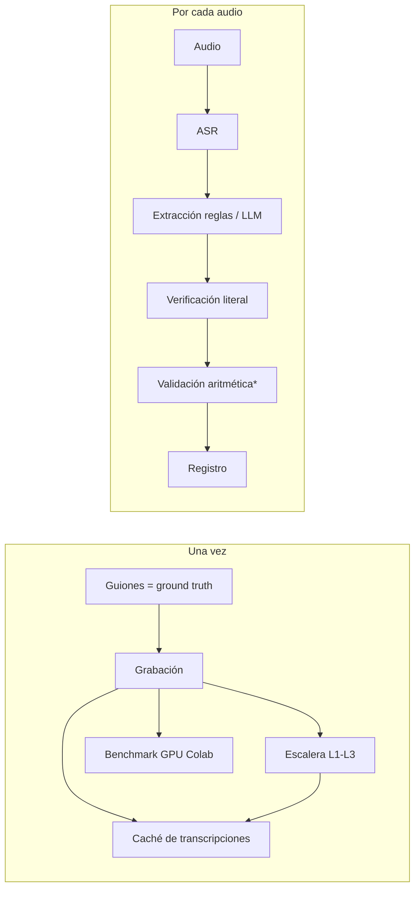

# De la voz al registro — entrevistas y llamadas de venta

Proyecto integrador HW_05 (Data Science con Python). Un **único motor** convierte audio en un
registro estructurado y **verificado**:

- **Tarea 1 — Entrevistas:** una entrevista de trabajo grabada → registro del candidato con 6 campos.
- **Tarea 2 — Llamadas de venta (dominio: restaurante):** un pedido telefónico → registro del pedido
  que **se valida a sí mismo** con aritmética y diagnostica si un descuadre viene del ASR o del hablante.

| | |
|---|---|
| 🎬 Video (≤ 8 min) | _pendiente: enlace al video_ |
| 🧭 Documento del pipeline (Notion, público) | https://profuse-smelt-c45.notion.site/Tarea-5-Pipeline-de-la-voz-al-registro-40ab1cf1617e8118abf4e29ce51667b6 |
| 🧪 Notebook GPU (Colab) | [notebooks/benchmark_gpu_colab.ipynb](notebooks/benchmark_gpu_colab.ipynb) |

> **Datos inventados.** Todo lo que se dice en los audios es inventado: nombres de personajes,
> empresas, salarios, direcciones, pedidos y montos. No hay datos personales reales de nadie.
>
> **Consentimiento.** Todas las personas que aparecen en las grabaciones aceptaron ser grabadas y que
> su voz se use en este proyecto. La persona que grabó conmigo prefirió no ser nombrada.

---

## 1. Instalación y ejecución

```bash
python -m venv .venv && source .venv/bin/activate
pip install -r requirements.txt
cp .env.example .env            # y completar OPENAI_API_KEY (solo para el camino LLM con OpenAI)

streamlit run app.py            # la app: carga resultados precalculados, no re-transcribe
```

Comandos del pipeline (cada uno lee todo de `config.yaml`):

| Comando | Qué hace | Cuándo |
|---|---|---|
| `python -m scripts.transcribir_corpus --glosario --escalera` | Transcribe L0, variantes de glosario y escalera L1–L3 a `data/transcripciones/` | Una vez (CPU: ~40 min) |
| Notebook de Colab | Benchmark GPU: 2 modelos × float16/int8 × GPU/CPU + glosario → `results/benchmark_gpu.json` | Una vez, con GPU |
| `python -m scripts.evaluar` | Extrae (reglas, OpenAI, Ollama), verifica, valida y mide ambas capas → `results/` | Tras transcribir |
| `python -m scripts.tablas_readme` | Genera `results/tablas.md` con las tablas de este README | Tras evaluar |
| `python -m scripts.regresion` | Gate de regresión desde caché (lo corre GitHub Actions) | En cada push / PR |

Camino LLM local (opcional): instalar [Ollama](https://ollama.com) y `ollama pull qwen2.5:3b`.

**Audios.** Los audios y los pesos de los modelos **no** están en el repositorio. Las transcripciones
sí están en caché (`data/transcripciones/`), así que la evaluación, la app y el CI funcionan sin
audios. Para regenerar todo desde cero, los audios se pueden solicitar al autor; se colocan en
`audio/` como `E01.m4a … V05.m4a`. Los modelos se descargan solos desde Hugging Face la primera vez.

## 2. Arquitectura: un motor, dos tareas

```
src/
  engine.py          ← procesar_audio(): la ÚNICA función que llaman la app, la evaluación y el CI
  asr.py             ← faster-whisper; dispositivo leído en runtime; VRAM pico con NVML
  normalizacion.py   ← regla de normalización (WER y verificación)
  numeros.py         ← "seis mil quinientos" → 6500
  extraccion/reglas.py, extraccion/llm.py   ← los dos caminos de extracción
  verificacion.py    ← regla de verificación literal
  validacion.py      ← validación aritmética + diagnóstico ASR/hablante
  metricas.py        ← WER/CER, exactitud por campo, F1 macro, MAE, IC
  degradacion.py     ← escalera L0–L3
config.yaml          ← rutas, modelos, umbrales, prompts, catálogos (nada de esto vive en el código)
```

`procesar_audio(ruta_audio, esquema, metodo, proveedor, transcripcion=None)` devuelve
`transcripcion`, `campos`, `evidencias`, `verificacion` (qué campos se verificaron), `validacion`
(solo llamadas), `dispositivo`, `segundos` y `error`.

**Cómo un módulo sirve a dos esquemas.** `engine.ESQUEMAS` es un registro con una entrada por
esquema: la lista de campos, la clave del prompt en `config.yaml`, la función de reglas y si se
valida la aritmética. Agregar un tercer esquema es agregar una entrada; cambiar el modelo de ASR o
de LLM es cambiar una línea de `config.yaml`, y las dos tareas lo heredan. No se copió ni se editó
el motor para la Tarea 2.

**El motor no importa ninguna librería de interfaz.** Comando de verificación (también corre en CI):

```bash
grep -nE '^\s*(import|from)\s+(streamlit|telegram|gradio)' src/engine.py   # sin salida = OK
python -c "import sys, src.engine; print('streamlit' in sys.modules)"      # False
```

## 3. Pipeline

Documento visual completo (qué corre una vez, qué corre por audio, decisiones y lo descartado):
**[Notion](https://profuse-smelt-c45.notion.site/Tarea-5-Pipeline-de-la-voz-al-registro-40ab1cf1617e8118abf4e29ce51667b6)**.


\* solo en el esquema de llamada.

## 4. Corpus y ground truth

- **5 entrevistas + 5 llamadas**, de 2:06 a 3:12 cada una (≈ 12.9 min de entrevistas y ≈ 11.4 min de
  llamadas), grabadas en persona con un celular. Aparezco en los 10 clips; los roles A/B se alternan.
- **Ground truth gratis:** los guiones ([guiones/](guiones/)) se escribieron **antes** de grabar. La
  transcripción de referencia son las líneas leídas y los valores correctos están en
  [data/ground_truth/](data/ground_truth/). No se usó ningún subtítulo automático como referencia.
- **Variación deliberada (Tarea 1):** cada campo cambia de posición y de forma: salario preguntado
  al inicio (E02) o al final; jerga ("cinco lucas"); autocorrección ("cuatro mil ochocientos… no,
  perdón, cinco mil doscientos"); distractor (sueldo actual antes de la pretensión, E05); inglés como
  "B2, intermedio alto"; experiencia en tramos (3 + 1.5) o como "una década"; disponibilidad
  relativa, absoluta o inmediata; salario en dólares.
- **Trampas (Tarea 2, dominio restaurante):** 4 llamadas con autocorrección (mínimo 3), 3 con total mal
  dicho a propósito (mínimo 3) y con **causas distintas** (promoción no descontada, error de suma,
  total del pedido antes de corregir), y las 5 con dirección con dígitos.

#### Corpus de entrevistas: distribución de los campos

| clip   |   anios_experiencia | ultimo_puesto                    |   n_tecnologias | pretension   | disponibilidad             | nivel_ingles   |
|:-------|--------------------:|:---------------------------------|----------------:|:-------------|:---------------------------|:---------------|
| E01    |               4.500 | analista de datos senior         |               4 | 6500 PEN     | 2026-11-13 (relativa_dias) | intermedio     |
| E02    |               7.000 | backend developer                |               5 | 5000 PEN     | 2026-10-30 (inmediata)     | avanzado       |
| E03    |              10.000 | líder de proyectos de tecnología |               4 | 5200 PEN     | 2026-12-01 (fecha)         | basico         |
| E04    |               2.500 | ML engineer                      |               5 | 2800 USD     | 2026-11-29 (relativa_dias) | intermedio     |
| E05    |               6.000 | ingeniera de datos               |               6 | 9000 PEN     | 2026-11-06 (relativa_dias) | avanzado       |

#### Corpus de llamadas: distribución y trampas

| clip   |   n_items |   unidades | promocion                       | metodo_pago   |   total_dicho |   total_correcto | autocorreccion   | total_erroneo   | tipo_error            |
|:-------|----------:|-----------:|:--------------------------------|:--------------|--------------:|-----------------:|:-----------------|:----------------|:----------------------|
| V01    |         4 |          4 | combo familiar                  | yape          |            87 |               87 | True             | False           | nan                   |
| V02    |         4 |          5 | martes de pizza 2x1 en medianas | efectivo      |           102 |               70 | True             | True            | promocion_no_aplicada |
| V03    |         3 |          4 | código BARRIO15                 | tarjeta       |            85 |               95 | False            | True            | error_suma            |
| V04    |         4 |          5 | nan                             | plin          |            66 |               66 | True             | False           | nan                   |
| V05    |         3 |          3 | nan                             | transferencia |            63 |               74 | True             | True            | total_pedido_previo   |


## 5. Tarea 1 — Transcripción en GPU

**Evidencia de que se usó la GPU.** El dispositivo se lee en tiempo de ejecución de
`WhisperModel.model.device` (no de `config.yaml`) y se respalda con la VRAM medida con NVML en un
hilo que muestrea cada 50 ms mientras se transcribe. La corrida en CPU no agrega VRAM (0 MB sobre la
línea base) y es 38 veces más lenta: si el pipeline hubiera caído a CPU en silencio, estas dos
columnas lo delatarían. Benchmark corrido en Colab: [notebook](notebooks/benchmark_gpu_colab.ipynb),
datos en [results/benchmark_gpu.json](results/benchmark_gpu.json).

| modelo         | dispositivo_pedido   | dispositivo_real   | precision   | modo_glosario   |   wer |   cer |   seg_por_min_audio |   vram_pico_mb |   vram_modelo_mb |
|:---------------|:---------------------|:-------------------|:------------|:----------------|------:|------:|--------------------:|---------------:|-----------------:|
| large-v3-turbo | cpu                  | cpu                | int8        | ninguno         | 0.040 | 0.018 |              70.130 |        556.188 |            0.000 |
| large-v3-turbo | cuda                 | cuda               | float16     | hotwords        | 0.250 | 0.207 |               2.758 |       2524.588 |         1968.400 |
| large-v3-turbo | cuda                 | cuda               | float16     | initial_prompt  | 0.048 | 0.020 |               1.978 |       2390.188 |         1834.000 |
| large-v3-turbo | cuda                 | cuda               | float16     | ninguno         | 0.045 | 0.019 |               1.854 |       2390.188 |         1834.000 |
| large-v3-turbo | cuda                 | cuda               | int8        | ninguno         | 0.052 | 0.022 |               1.808 |       1590.188 |         1034.000 |
| small          | cuda                 | cuda               | float16     | ninguno         | 0.077 | 0.031 |               1.694 |       1327.788 |          877.600 |
| small          | cuda                 | cuda               | int8        | ninguno         | 0.079 | 0.035 |               1.706 |       1046.188 |          490.000 |

`vram_modelo_mb` = pico durante la transcripción menos la VRAM usada antes de cargar el modelo.

- **Dos tamaños:** `large-v3-turbo` reduce el WER de 7.7% a 4.5% frente a `small` (float16), con
  la misma velocidad en una T4 (~1.8 s por minuto de audio) y el doble de VRAM.
- **CPU vs GPU:** 70.1 vs 1.85 s por minuto de audio (×38). El texto es idéntico en E01 y difiere en
  0.8% de las palabras en E02.
- **float16 vs int8:** int8 ahorra 44% de VRAM en el modelo grande (1 834 → 1 034 MB) sin ganar
  velocidad en la T4, y **el texto cambia en 9 de 10 casos**; en E04 difiere el 6.9% de las palabras
  y el WER sube de 5.2% a 7.7%. Más liviano no es gratis: hay que medir el texto, no solo el tiempo.

| modelo         | clip   | texto_identico   |   wer_entre_float16_e_int8 |
|:---------------|:-------|:-----------------|---------------------------:|
| small          | E01    | False            |                      0.009 |
| small          | E02    | False            |                      0.046 |
| small          | E03    | False            |                      0.021 |
| small          | E04    | False            |                      0.025 |
| small          | E05    | False            |                      0.015 |
| large-v3-turbo | E01    | False            |                      0.005 |
| large-v3-turbo | E02    | True             |                      0.000 |
| large-v3-turbo | E03    | False            |                      0.012 |
| large-v3-turbo | E04    | False            |                      0.069 |
| large-v3-turbo | E05    | False            |                      0.012 |

**Hallazgo de entorno (reproducibilidad).** En Colab (Python 3.13, CUDA 13) CTranslate2 4.8 falla con
`libcublas.so.12 is not found`. Se resolvió instalando `nvidia-cublas-cu12` y `nvidia-cudnn-cu12` por
pip y precargándolas con `ctypes` en [src/asr.py](src/asr.py) (`LD_LIBRARY_PATH` solo se lee al iniciar
el proceso).

### Glosario de dominio: ¿qué mecanismo y en qué versión?

`faster-whisper==1.2.1` ofrece dos mecanismos y la documentación pública no aclara la diferencia.
Leyendo el código fuente (`WhisperModel.get_prompt`):

- `initial_prompt` solo condiciona la **primera** ventana de 30 s; después se reemplaza por el texto
  ya transcrito (`condition_on_previous_text`).
- `hotwords` (agregado en 1.0.x) se inyecta como contexto previo en **todas** las ventanas, salvo que
  se use `prefix`.

| modo           |   wer_sin |   wer_con |   dif_wer_media | ic95_dif         |   terminos_total |   recuperados_sin |   recuperados_con |
|:---------------|----------:|----------:|----------------:|:-----------------|-----------------:|------------------:|------------------:|
| hotwords       |     0.047 |     0.272 |           0.225 | [+0.166, +0.267] |               27 |                21 |                22 |
| initial_prompt |     0.047 |     0.050 |           0.003 | [-0.001, +0.009] |               27 |                21 |                22 |

`ic95_dif` es un IC bootstrap (10 000 remuestreos por clip) de la diferencia de WER pareada.
`initial_prompt` no tiene efecto medible (el IC incluye el 0). **`hotwords` multiplica el WER por 5.5**
(el IC excluye el 0; mismo resultado en GPU float16: 25.0%): con una lista de 34 términos en cada
ventana, el modelo entra en bucles ("lo primero es decirlo temprano, lo primero es decirlo
temprano…") y borra tramos enteros (E03: 48 palabras omitidas). Ninguno de los dos recupera los
nombres que más importan (Airflow, Snowflake, Git, scikit-learn): 21 → 22 de 27 términos. Con 5 clips
la muestra no permite afirmar que un glosario más corto no ayudaría; sí permite descartar `hotwords`
con esta lista.

**Regla de normalización** (misma para referencia e hipótesis, [src/normalizacion.py](src/normalizacion.py)):
minúsculas; sin tildes (la ñ se conserva); letras y dígitos pegados se separan ("BARRIO15" → "barrio 15");
sin puntuación; números en palabras → dígitos ("seis mil quinientos" → "6500"; "y" solo une decena
con unidad); separadores de miles del ASR eliminados ("6.500" → "6500"); muletillas fuera ("eh", "mmm").

## 6. Tarea 1 — Del texto al registro

Dos caminos sobre la misma transcripción (`large-v3-turbo`, int8): **reglas** (regex + catálogos de
`config.yaml`) y **LLM con JSON** (OpenAI `gpt-4o-mini` y, como contraste local y gratuito, Ollama
`qwen2.5:3b`). Ambos devuelven `valor` + `evidencia` por campo.

**Capa transcripción:**

| clip   |   wer |   cer | dispositivo   |   seg_por_min_audio |
|:-------|------:|------:|:--------------|--------------------:|
| E01    | 0.041 | 0.021 | cpu           |              26.640 |
| E02    | 0.038 | 0.014 | cpu           |              28.900 |
| E03    | 0.046 | 0.018 | cpu           |              49.340 |
| E04    | 0.055 | 0.025 | cpu           |              31.580 |
| E05    | 0.055 | 0.025 | cpu           |              34.720 |

**Capa registro** (exactitud por campo, n = 5, IC 95% de Wilson):

| campo               | llm_ollama        | llm_openai        | reglas            |
|:--------------------|:------------------|:------------------|:------------------|
| anios_experiencia   | 1.00 [0.57, 1.00] | 1.00 [0.57, 1.00] | 1.00 [0.57, 1.00] |
| disponibilidad      | 0.20 [0.04, 0.62] | 1.00 [0.57, 1.00] | 1.00 [0.57, 1.00] |
| nivel_ingles        | 0.80 [0.38, 0.96] | 1.00 [0.57, 1.00] | 1.00 [0.57, 1.00] |
| pretension_salarial | 0.60 [0.23, 0.88] | 1.00 [0.57, 1.00] | 1.00 [0.57, 1.00] |
| registro_completo   | 0.00 [0.00, 0.43] | 0.40 [0.12, 0.77] | 0.40 [0.12, 0.77] |
| tecnologias         | 0.40 [0.12, 0.77] | 0.40 [0.12, 0.77] | 0.40 [0.12, 0.77] |
| ultimo_puesto       | 0.40 [0.12, 0.77] | 1.00 [0.57, 1.00] | 0.80 [0.38, 0.96] |

F1 macro de `nivel_ingles`: llm_ollama = 0.889, llm_openai = 1.000, reglas = 1.000

| metodo     |   error_abs_anios |   error_abs_salario |
|:-----------|------------------:|--------------------:|
| llm_ollama |             0.000 |             999.000 |
| llm_openai |             0.000 |               0.000 |
| reglas     |             0.000 |               0.000 |

**Regla de verificación.** Todo valor extraído debe aparecer **literalmente** en la transcripción
normalizada; si no, el campo queda `sin_verificar` ([src/verificacion.py](src/verificacion.py)).
La capa de normalización numérica es lo que permite verificar "seis mil quinientos" contra `6500`;
además: "N lucas" → "N000 soles", "N años y medio" → "N.5 años", "una década" → "10 años",
"primero de diciembre" → "1 de diciembre".

| metodo     | verificacion   |   False |   True |
|:-----------|:---------------|--------:|-------:|
| llm_ollama | sin_verificar  |   5.000 |  0.000 |
| llm_ollama | verificado     |   8.000 | 17.000 |
| llm_openai | verificado     |   3.000 | 27.000 |
| reglas     | vacio          |   1.000 |  0.000 |
| reglas     | verificado     |   3.000 | 26.000 |

La verificación **atrapó todo lo que el LLM local inventó** (5 de 5 `sin_verificar` eran incorrectos:
"5" soles a partir de "cinco lucas", "inmediata" donde se dijo "en dos semanas"). Pero **no puede
atrapar errores del ASR**: cuando Whisper escribe "iFlow", "Snowbreak" o "JIT", el LLM los copia, el
valor existe literalmente y queda `verificado` aunque sea incorrecto. Verificado significa "lo dijo
la transcripción", no "es verdad".

**El campo categórico sobrevive, el texto propio no.** `nivel_ingles` (3 clases, F1 macro = 1.0 con
OpenAI y reglas) y los numéricos dichos con claridad salen perfectos; `tecnologias` falla en 3 de 5
clips con los tres métodos porque depende de nombres propios en inglés dentro de español. Un error de
una palabra destruye una cifra o un nombre, pero no una categoría con pocas clases.

### ¿Se puede juzgar el registro mirando solo el WER? No.

Correlación de Spearman entre WER y exactitud del registro, sobre las 75 combinaciones
(clip × nivel × método): **ρ = −0.45**. Hay relación, pero no sirve para decidir clip por clip:

- **WER alto, registro perfecto — V04 en L1 (OpenAI): WER 10.0%, 5/5 campos correctos.** La mayoría
  de los errores cayeron en saludos y relleno ("le atiende" → "la tienda", "kion" → "quinoa").
  Pero uno cayó en un campo: "con Plin" → "compline". El LLM escribió `plin` igual: **corrigió en
  silencio y acertó**. La verificación lo marcó `sin_verificar`, que es lo correcto: la próxima vez
  corregirá y se equivocará.
- **WER bajo, registro roto — E05 en L0: WER 5.5% y `tecnologias` incorrecto con los tres métodos**
  ("Airflow" → "iFort", "Snowflake" → "Snowbreak", "Git" → "JIT"). Tres palabras de ~340 bastan.
- Otro caso: **V02 en L0, WER 1.7%**, y OpenAI **inventó un descuento de 50** para el 2x1 (el monto
  nunca se dice; es 32). Peor: quedó `verificado`, porque "cincuenta" sí aparece en la llamada
  ("cincuenta minutos" de espera). La verificación literal comprueba que el número exista en la
  transcripción, no que esté donde corresponde.

Quien reporta solo WER está midiendo cuántas palabras se oyeron, no si **las palabras que importan**
se oyeron. El WER pondera igual "eh" que "seis mil quinientos".

## 7. Tarea 2 — Llamadas de venta

Dominio: **restaurante** ("Sabor de Barrio", ficticio, [carta](guiones/carta_restaurante.md)).
Campos: `items` (producto, tamaño, cantidad, precio unitario), `promocion`, `direccion_entrega`,
`metodo_pago`, `total_dicho`. **Mismo motor, mismo `procesar_audio`**, esquema `"llamada"`.

### Escalera de degradación

| Nivel | Simula | Transformación ([src/degradacion.py](src/degradacion.py)) |
|---|---|---|
| L0 | Como se grabó | sin cambios |
| L1 | Nota de voz de WhatsApp | mono, Opus 12 kbps, 16 kHz |
| L2 | Llamada telefónica | Butterworth pasa-banda 300–3400 Hz (orden 6) y remuestreo a 8 kHz |
| L3 | Ambiente ruidoso | L1 + ruido de conversación (babble de 4 entrevistas superpuestas) a **5 dB** |

**Por qué 5 dB y cómo se midió.** Una conversación en un restaurante o una calle con gente ronda 0–10
dB de SNR; 5 dB es el centro de ese rango. Se usó *babble* (voces) y no ruido blanco porque es el
ruido que más confunde a un ASR: compite con la voz en las mismas frecuencias. La SNR se **mide**:
potencia de la voz en los tramos activos (ventanas de 20 ms por encima del percentil 30 de energía)
contra la potencia del ruido escalado. Resultado: 5.0 dB sobre voz activa y 3.5 dB sobre la señal
completa, en los 5 clips. Las fuentes del babble son las entrevistas, nunca las propias llamadas.

| nivel   | metodo     |   wer_medio |   cer_medio |   exactitud_campos |   exactitud_items |   exactitud_total_dicho |
|:--------|:-----------|------------:|------------:|-------------------:|------------------:|------------------------:|
| L0      | llm_ollama |       0.044 |       0.016 |              0.800 |             0.600 |                   1.000 |
| L0      | llm_openai |       0.044 |       0.016 |              0.960 |             1.000 |                   1.000 |
| L0      | reglas     |       0.044 |       0.016 |              0.680 |             0.600 |                   0.800 |
| L1      | llm_ollama |       0.071 |       0.032 |              0.720 |             0.200 |                   0.800 |
| L1      | llm_openai |       0.071 |       0.032 |              0.920 |             0.800 |                   1.000 |
| L1      | reglas     |       0.071 |       0.032 |              0.640 |             0.600 |                   0.800 |
| L2      | llm_ollama |       0.154 |       0.116 |              0.680 |             0.000 |                   1.000 |
| L2      | llm_openai |       0.154 |       0.116 |              0.800 |             0.400 |                   1.000 |
| L2      | reglas     |       0.154 |       0.116 |              0.680 |             0.400 |                   0.800 |
| L3      | llm_ollama |       0.423 |       0.277 |              0.560 |             0.000 |                   1.000 |
| L3      | llm_openai |       0.423 |       0.277 |              0.680 |             0.200 |                   1.000 |
| L3      | reglas     |       0.423 |       0.277 |              0.480 |             0.000 |                   0.800 |

El WER sube de 4.4% a 42.3% y la exactitud del registro (OpenAI) baja de 96% a 68%: la escalera sí
degrada; en L3 ningún método queda perfecto, así que no fue necesario endurecerla más. `total_dicho`
resiste (es la frase más enfática de la llamada); `items` es lo primero que se rompe.

### Validación aritmética y diagnóstico

`Σ cantidad × precio_unitario − descuento = total_dicho` (tolerancia S/ 0.50,
[src/validacion.py](src/validacion.py)). Cuando no cuadra, el sistema encontró un problema **sin
ningún ground truth**. Regla de diagnóstico, en orden:

1. **ASR** si algún precio extraído no coincide con la carta (un número se oyó mal).
2. **ASR** si la confianza media de Whisper en las palabras del total es < 0.75.
3. **Hablante** si la diferencia es exactamente el descuento (promoción no aplicada), el subtotal o
   precio de un ítem (ítem omitido/sobrante), o si otra combinación de cantidades da el total dicho
   (total del pedido antes de corregir).
4. **ASR** si total y calculado forman un par que suena parecido (60/70, 15/50…).
5. En otro caso, **hablante** (el ASR estaba seguro de lo que oyó).

Causa real para puntuar: **hablante** si la llamada tenía total mal dicho a propósito y el total
extraído es el realmente dicho; **ASR/extracción** en cualquier otro descuadre.

| nivel   | metodo     |   trampas |   detectados |   omitidos |   falsas_alarmas |   no_verificables |   diagnosticos_evaluados |   diagnosticos_correctos |
|:--------|:-----------|----------:|-------------:|-----------:|-----------------:|------------------:|-------------------------:|-------------------------:|
| L0      | llm_ollama |         3 |            2 |          1 |                1 |                 0 |                        3 |                        1 |
| L0      | llm_openai |         3 |            3 |          0 |                0 |                 0 |                        3 |                        3 |
| L0      | reglas     |         3 |            2 |          1 |                0 |                 2 |                        2 |                        2 |
| L1      | llm_ollama |         3 |            2 |          1 |                1 |                 1 |                        3 |                        2 |
| L1      | llm_openai |         3 |            3 |          0 |                0 |                 0 |                        3 |                        3 |
| L1      | reglas     |         3 |            3 |          0 |                0 |                 1 |                        3 |                        3 |
| L2      | llm_ollama |         3 |            3 |          0 |                2 |                 0 |                        5 |                        1 |
| L2      | llm_openai |         3 |            3 |          0 |                0 |                 0 |                        3 |                        3 |
| L2      | reglas     |         3 |            3 |          0 |                0 |                 1 |                        3 |                        3 |
| L3      | llm_ollama |         3 |            3 |          0 |                1 |                 0 |                        4 |                        2 |
| L3      | llm_openai |         3 |            2 |          1 |                1 |                 0 |                        3 |                        3 |
| L3      | reglas     |         3 |            3 |          0 |                1 |                 1 |                        4 |                        3 |

- **Con OpenAI, el validador atrapa 11 de 12 totales mal dichos en los 4 niveles, con 1 falsa alarma,
  y el diagnóstico acierta 12 de 12.** La falsa alarma (V01 en L3) es real: el ASR oyó "6" en lugar de
  "12" en el precio de la chicha, y la regla 1 la atribuyó correctamente al ASR.
- **Lo que se le escapa:** V02 en L3 — el ruido deformó "martes de pizza: dos por uno" en "martes y
  2 2 por 1"; el LLM registró una promoción sin monto (queda `sin_verificar`), el descuento cuenta
  como 0 y 102 = 102 *cuadra*. El error del hablante (no descontar) y el del ASR se cancelaron. La
  validación detecta inconsistencias, no omisiones coherentes.
- Con reglas, varios pedidos quedan `no_verificable` (falta un precio): el validador necesita un
  registro completo para opinar.
- **Cautela:** la regla de diagnóstico la diseñé conociendo las tres trampas; con 12 casos evaluados
  por método, el 100% no es una tasa de acierto generalizable.

## 8. Limitaciones — lo que esta muestra no permite afirmar

- **n = 5 por tarea, dos voces, un celular, un cuarto.** Los IC de Wilson de una exactitud de 1.0
  van de 0.57 a 1.0. Solo las diferencias extremas tienen intervalos que no se solapan (`hotwords` vs
  sin glosario; `disponibilidad` de Ollama 1/5 vs OpenAI 5/5); las demás comparaciones entre métodos
  no son concluyentes.
- **Las reglas están sobreajustadas al corpus:** las escribí viendo los guiones. Su buen desempeño
  (igual a OpenAI en la Tarea 1) es optimista; con guiones nuevos caería. El LLM no vio los guiones.
- **La referencia es el guion leído**, no una transcripción del audio: si alguien leyó una palabra
  distinta, cuenta como error del ASR.
- La puntuación de `ultimo_puesto` y `direccion_entrega` usa similitud de texto ≥ 0.8: un umbral
  elegido por mí.
- Los ítems se comparan por producto y tamaño; los sabores de pizza no se puntúan.
- La verificación de fechas comprueba día y mes, no el año (antes de dar al LLM la fecha de la
  entrevista en el prompt, OpenAI fechó "primero de diciembre" en 2023 y quedó `verificado`).
- La verificación numérica busca el número en toda la transcripción, no junto al campo: un número
  inventado que coincide con otro dicho en la llamada pasa (caso del descuento de 50 en V02).
- La caché de transcripciones se hizo en CPU (int8) por tiempo; las comparaciones en GPU están en el
  benchmark de Colab. Ambos usan `large-v3-turbo` y dan WER parecidos (4.7% vs 4.5%).

**Este sistema nunca debe usarse** para decidir una contratación ni un cobro sin revisión humana, ni
con audios de personas que no consintieron ser grabadas. "Verificado" no significa "verdadero".

## 9. Innovación

- **Gate de regresión en GitHub Actions** ([.github/workflows/regresion.yml](.github/workflows/regresion.yml),
  [scripts/regresion.py](scripts/regresion.py)): recalcula las métricas **desde la caché** y falla si
  el WER sube o la exactitud baja de los umbrales de `config.yaml`. Los runners no tienen GPU:
  transcribir ahí tardaría horas, así que el gate evalúa transcripciones y registros LLM guardados y
  recalcula todo lo demás (reglas, normalización, verificación, validación, métricas). También verifica
  que el motor no importe librerías de interfaz.
- **Extracción local y gratuita como contraste** (Ollama `qwen2.5:3b`): los datos no salen de la
  máquina. Resultado honesto: con 3B parámetros extrae peor (registro completo 0/5) y la verificación
  literal es lo que impide que esos errores pasen como datos.

## 10. Herramientas de IA y servidores MCP

- **Claude Code** (Claude Opus 5.5): escribió la mayor parte del código bajo mi dirección; diseñamos
  juntos guiones, trampas, reglas y métricas. Revisé cada módulo y puedo explicarlo y modificarlo.
- **MCP de Notion** (conector de claude.ai): creó la página del pipeline en mi espacio de Notion.
- **MCP de Google Drive** (conector de claude.ai): verificó que los 10 audios estuvieran en la carpeta
  de Drive que monta el notebook de Colab.
- **MCP del IDE (VS Code)**: contexto de los archivos abiertos durante el desarrollo.
- **OpenAI API** (`gpt-4o-mini`) y **Ollama** (`qwen2.5:3b`): los dos proveedores del camino LLM.

